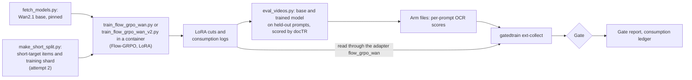

# gatedtrain recipe: Flow-GRPO Wan2.1 video OCR

This recipe teaches a small text-to-video model to render the quoted text of a prompt legibly in a short
video (flow_grpo's OCR task on video), and lets [gatedtrain](https://github.com/gatedtrain/gatedtrain) decide whether the trained model really is better than the one
it started from. Flow-GRPO trains a LoRA on Wan2.1-T2V-1.3B (Diffusers layout), with a minimal port of flow_grpo's
`scripts/train_wan2_1.py` (`yifan123/flow_grpo` at `879042cf`, MIT) on diffusers and peft. The training reward is
flow_grpo's video OCR reward with PaddleOCR PP-OCRv4 (every 4th frame). gatedtrain then gates the trained LoRA against
the base model on held-out prompts, scored over all frames by a second OCR engine (docTR), by a rule registered before
training.

A recipe is a ready-made external run for gatedtrain: the training code with its locked environment, plus an
*adapter*, the small plugin through which gatedtrain reads the run's outputs. gatedtrain does not start the training;
you run it.

This is a prototype: the result below is two registered attempts, not a benchmark claim.

## How it works



`gatedtrain ext-launch` checks the run request and prints the container command; you run it. The steps, flags and
arm files are explained in gatedtrain's [External runs](https://gatedtrain.github.io/gatedtrain/external-runs/) guide.
The container image, Python environment and OCR models come from the SD3.5 OCR recipe (see the dependency below).

## Result

Two registered attempts. The deciding metric in both is `ocr_b_acc` (docTR accuracy over all 17 frames of each video).
Attempt 1 failed. Attempt 2 is an amendment of attempt 1, registered after it: it uses short target texts (at most 2
words) only and a larger batch, so its PASS holds for that narrower item set.

| | Baseline (Wan2.1-T2V-1.3B) | Candidate | Gate |
|---|---|---|---|
| Attempt 1: 400 items, 60 epochs, cut 60 | 0.1554 | 0.1469 | **FAIL**: -0.0086, 95% cluster-bootstrap interval [-0.0201, 0.0022], p 0.94 |
| Attempt 2: 288 short-target items, 100 epochs, cut 100, 11.22 GPU-hours | 0.1456 | 0.1774 | **PASS**: +0.0318, 95% cluster-bootstrap interval [0.0152, 0.0494], p <= 7.3e-05 |

`RESULT.md` has the full record of both attempts: the registrations, the cause found for attempt 1, power, overlap
with training, the impact queries and the re-collection with this repository's adapter. The gate files are under
`results/2026-11-15/`.

## Dependency on the SD3.5 OCR recipe

This recipe has no training environment of its own. Every launch (training, base evaluation, cut evaluation) runs
the SD3.5 OCR recipe's runtime image and its runtime venv (`.venv/bin/python`, from that recipe's `runtime/uv.lock`,
whose SHA-256 the adapter pins), and reads that runtime's OCR models (`ocr-models/`, `MODELS.json`) and OCR data
source (`data-source/ocr/`).

- **Where it is found.** The adapter and the runtime scripts locate that runtime directory the same way:
  `GATEDTRAIN_RECIPE_FLOW_GRPO_WAN_VIDEO_OCR_RUNTIME` if set, else the sibling checkout
  `../gatedtrain-recipe-flow-grpo-sd35-ocr/runtime` (relative to this repository's root). The adapter mounts it read-only at
  its own path, reads the interpreter tree from its `.venv/pyvenv.cfg`, and allows the variable in the launch
  environment, so a launch that uses the override passes the same value into the container. The adapter does not
  import the SD3.5 recipe's Python package.
- **Image build chain.** The image is built from `container/Containerfile` (a byte-identical copy of the SD3.5 OCR
  recipe's): the
  `docker.io/nvidia/cuda:13.0.3-devel-ubuntu24.04` base pinned by digest plus the X11/GL system libraries that OpenCV
  loads, tagged locally `gatedtrain-a5-runtime:1`. Python and the venv are mounted read-only from the host; the image adds
  system libraries only. The adapter pins the resulting image ID (`IMAGE` in `adapter.py`); a rebuild elsewhere
  produces another ID, so update that pin when you rebuild.

A self-contained evaluation environment (own lock, OCR models and image) would remove this dependency; it is not
part of this prototype.

## Setup

```bash
pip install "gatedtrain @ git+https://github.com/gatedtrain/gatedtrain@v0.3.0"   # the framework, at the release this recipe was tested with
pip install -e .                      # the adapter, into the environment that runs gatedtrain
# the SD3.5 OCR recipe checked out beside this one, with its runtime set up (its README "Setup"): venv, OCR models,
# image (container/Containerfile)
cd runtime && python fetch_models.py  # the Wan2.1 base into models/, hashes into MODELS.json
```

The adapter finds the runtime at `runtime/` of this checkout, located from its own source tree, so a non-editable
install (a wheel) must set `GATEDTRAIN_RECIPE_FLOW_GRPO_WAN_VIDEO_RUNTIME` to the runtime directory (and
`GATEDTRAIN_RECIPE_FLOW_GRPO_WAN_VIDEO_OCR_RUNTIME` to the OCR runtime, whose default is the sibling checkout); the runs' outputs go under the host's gatedtrain output root (`<output_root>/flow-grpo-wan-video`).
`runtime/README.md` has the design notes: commands, mounts, profiles, the attempt-2 amendment and the decisions behind
the metric.

The scripts load model weights from safetensors files whose hashes they check (`models/MODELS.json`, the SD3.5 OCR
recipe's `MODELS.json`, each cut's `cut.json`). Load only bases, OCR models and cuts you produced or fetched with these
scripts.

## Layout

| Path | What |
|---|---|
| `src/gatedtrain_recipe_flow_grpo_wan_video/` | the gatedtrain adapter `flow_grpo_wan` (`adapter.py`, a subclass of gatedtrain's `gatedtrain.families.flow_grpo.FlowGrpoAdapter`) and its registry rows (`rows.py`), registered through the `gatedtrain.adapters` entry point |
| `runtime/` | what runs in the container: `train_flow_grpo_wan.py` (attempt 1) and `train_flow_grpo_wan_v2.py` (attempt 2, the amendment: other profiles and prompts only), `eval_videos.py` (video generation and both OCR scorers), `make_short_split.py` (attempt 2's short-target item set and training shard), `fetch_models.py` (downloads the Wan2.1 base and hashes every file into `models/MODELS.json`), the registered item sets (`items/`, `items-short/`), the training shards' metadata (`prompts/prompts_meta.json`, `prompts-short/prompts_meta.json`), `ITEMS-SOURCE.json`, the design notes (`runtime/README.md`) and the scripts' own CPU tests (`runtime/tests/`) |
| `tests/` | the adapter's tests on fixture runs (no GPU, no model needed) and gatedtrain's conformance check |
| `container/Containerfile` | the runtime image `gatedtrain-a5-runtime:1`: a byte-identical copy of the SD3.5 OCR recipe's `container/Containerfile` (CUDA base pinned by digest plus X11/GL libraries), so this repository builds its image on its own |
| `results/2026-11-15/gate/` | the gate files of both attempts (`spec.yaml`/`registration.yaml`: attempt 1; `spec-v2.yaml`/`registration-v2.yaml`: attempt 2, which amends attempt 1; redacted copies, see `RESULT.md`) |

Not in the repository (git-ignored, regenerated): `runtime/models/wan2.1-t2v-1.3b/` (`fetch_models.py`, Apache-2.0,
about 28.9 GB; revision and file hashes in `models/MODELS.json`), `runtime/hf-home/` and `runtime/hf-meta/`
(huggingface_hub's cache and download metadata), `runtime/prompts/train.jsonl` (a byte copy of the SD3.5 OCR recipe's
`runtime/prompts/train.jsonl`; hashes in `runtime/ITEMS-SOURCE.json` and `prompts_meta.json`),
`runtime/prompts-short/train.jsonl` (`make_short_split.py`; its hash is in `prompts-short/prompts_meta.json`).

In the code and the notes, "area 5" (`area5-sd35`, `<sd35-ocr-runtime>`) is the SD3.5 OCR recipe
([gatedtrain-recipe-flow-grpo-sd35-ocr](https://github.com/gatedtrain/gatedtrain-recipe-flow-grpo-sd35-ocr)) and its `runtime/`, whose
port this recipe was built from, and "area 3 (video)" (`area3-video`) is this recipe's `runtime/`.

## Tests

```bash
python -m unittest discover -s tests -t tests
```

Without the OCR runtime's venv the tests point `GATEDTRAIN_RECIPE_FLOW_GRPO_WAN_VIDEO_OCR_RUNTIME` at a temporary stand-in
(`tests/.stand-in-ocr-runtime-*/`, removed on exit). Two tests run only where the SD3.5 OCR recipe's adapter is
installed as well (the two sibling adapters stay apart). The real-file tests read the runtime, the OCR runtime, and the
GPU runs and their launch records when `GATEDTRAIN_RECIPE_FLOW_GRPO_WAN_VIDEO_OUTPUTS` and
`GATEDTRAIN_RECIPE_FLOW_GRPO_WAN_VIDEO_RECORDS` name them, and skip what is absent. The scripts' own CPU tests
(`runtime/tests/`) run with the OCR runtime's venv and a flow_grpo clone at `879042cf` (`FLOW_GRPO_DIR`, default
`../flow_grpo` beside this repository); see their docstrings. Their check of the copied training shard skips until
`python runtime/eval_videos.py --copy-items` has copied `runtime/prompts/train.jsonl` from the OCR runtime.

## Data and licenses

| What | Used for | License | Attribution and source |
|---|---|---|---|
| This repository | adapter, scripts, notes | Apache-2.0 (`LICENSE`) | the gatedtrain authors |
| flow_grpo code | ported into `runtime/*.py` | MIT (`THIRD_PARTY_NOTICES.md`) | Jie Liu, [yifan123/flow_grpo](https://github.com/yifan123/flow_grpo) @ `879042cf5707f8b90daa98d147d7deac2317c5da` |
| diffusers code (through flow_grpo's `wan_pipeline_with_logprob.py`) | the Wan sampling loop and SDE step in `runtime/*.py` | Apache-2.0 (`THIRD_PARTY_NOTICES.md`) | The Wan Team and The HuggingFace Team, [huggingface/diffusers](https://github.com/huggingface/diffusers) `pipeline_wan.py` @ `cb8e61ed2f792db8bcb9606c12e9ae7e400e4b49` |
| flow_grpo OCR prompts (`dataset/ocr/{train,test}.txt`) | training shards and item sets (`runtime/items*/`, test fixtures) | MIT, as part of the flow_grpo repository (`THIRD_PARTY_NOTICES.md`) | same commit |
| Wan2.1-T2V-1.3B (Diffusers layout, includes the umT5 text encoder) | base model, downloaded by `fetch_models.py`, not redistributed | Apache-2.0 (model card `license: apache-2.0`; its "License Agreement" section adds use restrictions and points to the repository's `LICENSE.txt`) | Wan-AI, [Wan-AI/Wan2.1-T2V-1.3B-Diffusers](https://huggingface.co/Wan-AI/Wan2.1-T2V-1.3B-Diffusers) @ `0fad780a534b6463e45facd96134c9f345acfa5b` |
| PaddleOCR PP-OCRv4 mobile det and en rec | training reward and the supporting metric (OCR engine A), from the SD3.5 OCR recipe's runtime | Apache-2.0 (model cards) | PaddlePaddle, `PaddlePaddle/PP-OCRv4_mobile_det` @ `3cc09f3a5b424e8e010abc7a4271aea12999c2f7`, `PaddlePaddle/en_PP-OCRv4_mobile_rec` @ `f97b62fdc0eb71c689393a19a4b21baa1795c9ab` |
| docTR db_resnet50 and crnn_vgg16_bn | deciding metric (OCR engine B), from the SD3.5 OCR recipe's runtime | Apache-2.0 | Mindee, [mindee/doctr](https://github.com/mindee/doctr) release assets (file SHA-256s in the SD3.5 recipe's `MODELS.json`) |
| Runtime image | every launch | the SD3.5 OCR recipe's `container/Containerfile`: `nvidia/cuda` base image under NVIDIA's container license terms, Ubuntu packages under their own licenses | see that recipe |
| Python packages (diffusers, peft, torch, transformers, paddleocr, paddlepaddle, python-doctr, rapidfuzz, ...) | the runtime venv | their own licenses (rapidfuzz, the edit distance of the OCR scores: MIT; the published runs used python-Levenshtein, `RESULT.md`) | the SD3.5 OCR recipe's `runtime/uv.lock` |

## Responsible use

This recipe fine-tunes and samples Wan2.1-T2V-1.3B, a text-to-video model, here trained to render text in videos. Use
it, and anything trained with it, only with care:

- Do not use it to create content that is illegal, infringes others' rights, harasses or demeans people, depicts real
  people without their consent, or is meant to deceive (for example fabricated news or evidence).
- Label generated videos as synthetic wherever they are published or shared.
- Do not use the text-rendering ability to forge documents, signs, captions or other text that others rely on.
- Follow the use restrictions of the Wan2.1 model card's "License Agreement" section ("Data and licenses" above), which
  also apply to a LoRA trained with this recipe.
- Comply with the laws that apply to synthetic media where you use it.

## License

Apache License 2.0 (`LICENSE`); attribution notice in `NOTICE`. Ported code and copied data, with their licenses
(yifan123/flow_grpo, MIT; huggingface/diffusers, Apache-2.0): `THIRD_PARTY_NOTICES.md`. Model weights, datasets and
the container image are not part of this repository and keep their own licenses ("Data and licenses" above).

Names of third-party projects and products are trademarks of their owners; this project is not affiliated with or
endorsed by them.
